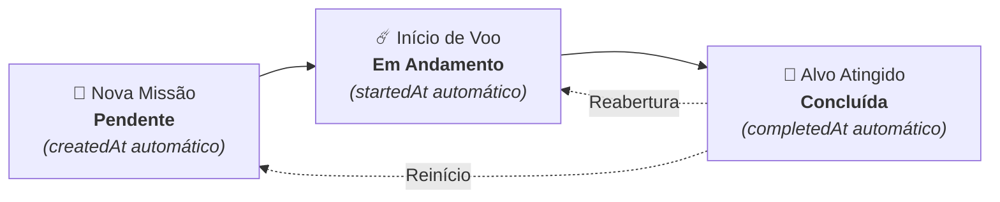

# 🚀 SpaceList - Centro de Controle de Missões Espaciais

-6366f1)


O **SpaceList** é uma aplicação web completa, imersiva e temática de gerenciamento de tarefas e objetivos, inspirada no universo da exploração espacial. O projeto combina conceitos modernos de interface do usuário (**UI/UX**), persistência de dados no navegador, gestão completa do ciclo de vida de tarefas e automação de datas e telemetria em tempo real.

---

## 🛰️ Visão Geral do Projeto

No **SpaceList**, cada atividade cadastrada é tratada como uma **Missão Espacial**. O usuário atua como o comandante da frota, acompanhado pelo copiloto oficial da tripulação: o mascote **Major Astro** (um astronauta interativo construído em formato vetorial SVG puro).

A aplicação conta com dois ambientes visuais com alternância dinâmica:
- ☀️ **Base de Lançamento (Tema Claro):** Visual limpo, tecnológico e de alto contraste, ideal para ambientes bem iluminados e planejamento pré-decolagem.
- 🌙 **Espaço Profundo (Tema Escuro):** Fundo cósmico com nebulosas e campo de estrelas cintilantes gerado dinamicamente via código.

---

## 🔄 Ciclo de Vida da Missão

Cada missão cadastrada possui um fluxo bem definido, com registro automático de marcas temporais:



---

## ✨ Funcionalidades Detalhadas

### 1. Gestão Completa de Estados da Missão
Cada missão transita entre três estados com diferenciação visual robusta:
- ⏳ **Pendente (`pending`)**: A missão foi planejada e aguarda inicialização (borda âmbar/laranja e data de criação).
- ☄️ **Em Andamento (`in_progress`)**: A missão está em trânsito pela tripulação (borda azul cósmico, fundo brilhante e data de início).
- 🚩 **Concluída (`completed`)**: A missão foi finalizada com sucesso (borda verde esmeralda, fundo verde suave, texto tachado, data de início e data de término).

### 2. Automação Inteligente de Datas
- **Data de Criação (`createdAt`)**: Registrada e formatada automaticamente no instante em que o objetivo é cadastrado.
- **Data e Hora de Início (`startedAt`)**: Registrada automaticamente assim que o status da missão muda para **"Em Andamento"** (`☄️ Início: DD/MM/AAAA às HH:mm`).
- **Data e Hora de Término (`completedAt`)**: Registrada e exibida automaticamente quando a missão é marcada como **"Concluída"** (`🏁 Término: DD/MM/AAAA às HH:mm`).
- Se uma missão concluída for reaberta, o sistema limpa a data de término de forma consistente, mantendo a integridade do histórico.

### 3. Painel de Estatísticas e Telemetria em Tempo Real
- **Painel de 4 Indicadores:** Total de missões, quantidade de missões Pendentes, Em Andamento e Concluídas.
- **Taxa de Conclusão Dinâmica:** Cálculo percentual exato em tempo real (`0%` a `100%`).
- **Barra de Progresso com Foguete:** Barra visual animada com um minifoguete (`🚀`) que viaja sobre o gradiente conforme a porcentagem aumenta.

### 4. Mascote Astronauta Reativo (Major Astro)
- **Ilustração Vetorial SVG Embutida:** Astronauta moderno com capacete, viseira reflexiva, luzes do traje espacial e mochila propulsora (*jetpack*).
- **Modo Pesquisa Estelar (Lista Vazia):** Quando não há missões na tela, o astronauta analisa mapas estelares e instrui o comandante a definir metas.
- **Modo Comemoração (100% de Conclusão):** Ao atingir a taxa máxima de sucesso, as **chamas animadas do jetpack** entram em ação (`@keyframes jetpackThrust`) e o balão de diálogo parabeniza a tripulação.

### 5. Tour Interativo de Boas-Vindas (Onboarding)
- **Modal Centralizado:** Card do tour posicionado no centro absoluto da tela (`top: 50%, left: 50%, transform: translate(-50%, -50%)`) com animação suave de zoom/fade-in.
- **Backdrop Estrelado:** Fundo escurecido simulando o Espaço Profundo, com estrelas cintilantes piscando via `@keyframes` CSS.
- **Animação do Foguete Espacial:** Um foguete (`🚀`) cruza a tela em diagonal ao fundo com um rastro luminoso de propulsão enquanto o modal estiver aberto.
- **Passo a Passo com o Astronauta:** 6 etapas guiadas com destaque de elementos (*spotlight*). O tour pode ser reaberto a qualquer momento pelo botão **"👨‍🚀 Tour Guiado"**.

### 6. Filtros e Persistência de Dados
- Filtros rápidos por abas: **Todas as Missões**, **⏳ Pendentes**, **☄️ Em Andamento** e **🚩 Concluídas**.
- Botão dedicado para limpeza em lote de missões já concluídas.
- Armazenamento no **LocalStorage** (`space_list_tasks`, `space_list_theme`, `space_list_tour_completed`), preservando os dados ao fechar ou atualizar o navegador.

---

## 📦 Estrutura de Dados da Missão

Cada missão é representada como um objeto JavaScript com a seguinte anatomia:

```json
{
  "id": 1730419200000,
  "text": "Calibrar os instrumentos da nave espacial",
  "status": "in_progress",
  "createdAt": "2026-10-31T23:50:00.000Z",
  "startedAt": "2026-10-31T23:55:00.000Z",
  "completedAt": null
}
```

---

## 🛠️ Tecnologias e Conceitos Aplicados

O projeto foi construído respeitando os fundamentos da web moderna, sem a utilização de bibliotecas externas:

| Tecnologia | Finalidade no Projeto |
| :--- | :--- |
| **HTML5 Semântico** | Estruturação acessível com `<main>`, `<header>`, `<section>`, `<form>`, `<button>`, `<aside>`, atributos `aria-*` e SVG inline. |
| **CSS3 Avançado** | Design Tokens com variáveis CSS, Grid Layout, Flexbox, backdrop-filter, animações `@keyframes` (estrelas, propulsores, foguete em diagonal). |
| **JavaScript (ES6+)** | Arquitetura orientada a estado (*State-Driven UI*), manipulação do DOM, funções puras, formatação de datas com a API `Date` e persistência via `localStorage`. |
| **SVG Vetorial** | Desenho do astronauta escalável e responsivo integrado diretamente no DOM com gradientes lineares e radiais. |

---

## 📂 Estrutura de Arquivos

```text
SpaceList/
├── index.html     # Marcação semântica da aplicação, modal de tour e estrutura SVG
├── style.css      # Sistema de temas, efeitos espaciais, animações e responsividade
├── script.js      # Lógica da aplicação, automação de datas, estatísticas e tour
└── README.md      # Documentação oficial do projeto
```

---

## 💻 Instruções de Execução

Não é necessário instalar ferramentas ou executar comandos de compilação:

1. Clone ou baixe este repositório para o seu computador.
2. Acesse a pasta do projeto:
   `c:\Users\Givanildo Barros\Downloads\dev-academy-main\dev-academy-main\Alura\SpaceList`
3. Dê um **duplo clique no arquivo `index.html`**.
4. A aplicação abrirá diretamente no seu navegador padrão (Google Chrome, Microsoft Edge, Mozilla Firefox, Opera, etc.).

---

## 🎓 Finalidade Acadêmica e Educacional

> [!IMPORTANT]
> **Declaração de Finalidade Acadêmica:**  
> Este projeto foi desenvolvido **exclusivamente para fins de estudo, prática de engenharia de software e aprendizado acadêmico**.  
> Ele tem como objetivo demonstrar a implementação prática de conceitos fundamentais da programação front-end moderna (arquitetura orientada a estado, manipulação de Document Object Model, design responsivo, persistência de dados local, acessibilidade e construção de interfaces interativas imersivas).
